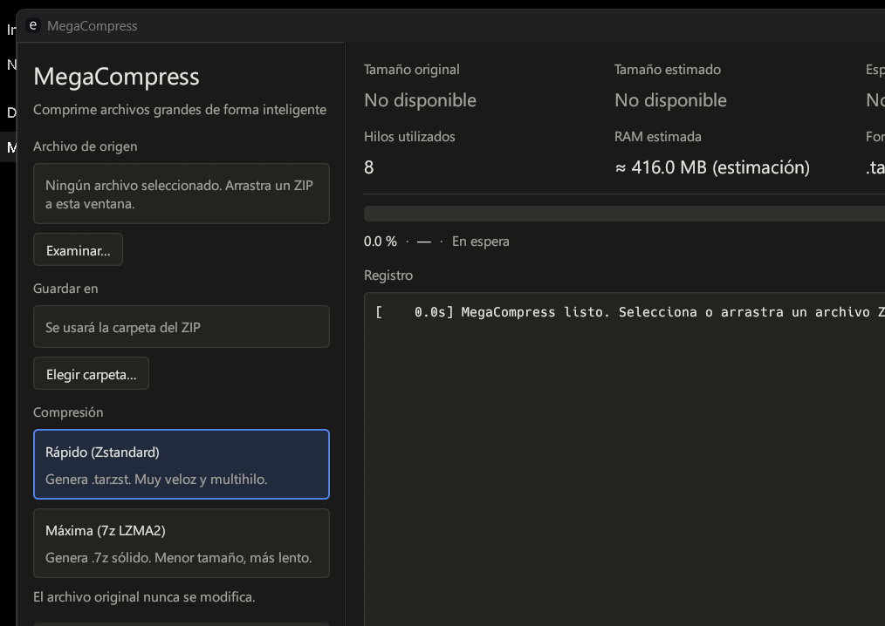

# MegaCompress

[Español](README.md) | **English**


Repackages a large ZIP into a more efficient container. One screen, dark mode:
**select ZIP → choose mode → COMPRESS**.

| Mode | Algorithm | Output |
|---|---|---|
| **Fast** | Multithreaded Zstandard (`zstdmt`, per-frame checksum) | `.tar.zst` |
| **Maximum** | Solid LZMA2 (`sevenz-rust2`, pure Rust) | `.7z` |

The output **is not a `.zip`**. The original ZIP is opened read-only and is **never modified or
deleted**. **Compression is not guaranteed**: if more than 70 % of the content is already compressed
(JPG, MP4, ZIP, PDF…), the app warns before starting and preselects Fast.



## Table of contents

- [Status](#status)
- [Download and build](#download-and-build)
- [Requirements](#requirements)
- [How it works](#how-it-works)
- [Security](#security)
- [Tests](#tests)
- [Known limitations](#known-limitations)
- [Project structure](#project-structure)
- [Manual measurements](#manual-measurements)
- [License](#license)

## Status

Built and tested on **Windows 11** with `rustc`/`cargo` **1.99.1** (`x86_64-pc-windows-gnu`):

| Command | Result |
|---|---|
| `cargo fmt --check` | OK |
| `cargo check --all-targets` | OK |
| `cargo test --all-targets` | **98 passed, 0 failed, 7 ignored** |
| `cargo clippy --all-targets --all-features -- -D warnings` | OK |
| `cargo build --release` | OK (3 min 38 s for the first build) |

The executable for this release is in `dist/MegaCompress.exe`. The app was launched and captured;
the screenshot is in [`docs/ui-window.png`](docs/ui-window.png). The visual check was done with OCR
and pixel sampling, not a full human inspection.

What is **not** tested: real tens-of-GB ZIPs, a real full disk, ZIP64 >4 GiB, Linux/macOS, and peak
RSS measurement. The RAM numbers in `mode.rs` and the UI's «estimated» sizes/times are still
estimates. See [`AUDIT.md`](AUDIT.md) for the honest details.

## Download and build

Binary included in the repository:

- [`dist/MegaCompress.exe`](dist/MegaCompress.exe) — 8,526,104 bytes
- SHA-256: `BAEC53FA41E7C03F04323ED631B857C30E41CC0285E5F1CF17B225FCCC44E72A`
- Depends only on system DLLs (no `libgcc` or `libstdc++`).
- **Not code-signed**: Windows SmartScreen may show a warning.

Build it yourself:

```bash
cargo fmt --check
cargo check --all-targets
cargo test --all-targets
cargo clippy --all-targets --all-features -- -D warnings
cargo build --release
```

The binary is written to `target/release/` (`megacompress.exe` on Windows).

## Requirements

- **Rust ≥ 1.89** (`rustup`): `std::fs::File::try_lock` is used to lock temporary files.
- **Windows:** MSVC toolchain (Visual Studio Build Tools, "Desktop development with C++") or GNU.
  This release was built with `x86_64-pc-windows-gnu`. `zstd` and `bzip2` compile C code;
  `sevenz-rust2` does not need C.
- **Linux:** C compiler, `pkg-config`, and GTK3 for the file dialog (`libgtk-3-dev` on
  Debian/Ubuntu), plus the usual eframe libraries (X11/Wayland, OpenGL). **Not tested in this
  release.**
- **macOS:** Xcode Command Line Tools. **Not tested in this release.**
- Font: a system font is loaded at startup (Segoe UI on Windows); if unavailable, egui's default
  font is used.

## How it works

```text
ZIP reader (1 thread) → CheckedReader (CRC32, size, cancellation, progress)
                      → Sink → close → full verification → publish
```

- **UI:** sidebar (source, destination, mode, COMPRESS/CANCEL) and main area (statistics, progress
  in three stages, console). Drag and drop a ZIP anywhere in the window.
- **Fast:** streaming TAR → `zstd::Encoder` (level and workers based on RAM/cores).
- **Maximum:** small entries are grouped into solid LZMA2 blocks (64/128/256 MB depending on RAM);
  an entry larger than the block is streamed as its own block.
- **Zero-byte files:** recorded without a stream in 7z (`has_stream = false`, `size = 0`) and
  verified separately. Tested with two empty files around a non-empty one.
- **Verification (both modes, always, before publishing):** the whole result is decompressed and
  each file's CRC32 and size are compared with the **original ZIP**. On any mismatch, nothing is
  published.
- **Progress:** 0–80 % compression (decompressed bytes delivered to the Sink); during finalization
  the bar stays at 80 % and the real step is shown (no invented percentage); 90–99.5 %
  verification; 100 % only appears after the result has been published.
- **Space:** estimated from the declared uncompressed size; only clearly infeasible cases are
  rejected, a warning is shown in the gray zone, and a full disk during the job is detected by
  **system error code** (not by text), everything stops, and the temporary file is deleted (original
  untouched).
- **Temporary files:** each operation creates `*.megacompress.lock` (locked by the OS) and
  `*.megacompress.tmp`. Two instances do not collide; cleanup never deletes an active temporary and
  recovers files from dead processes.
- **Publishing:** the final name is reserved with `create_new`; it never overwrites. If the name
  exists, it uses `file (1).ext`, `file (2).ext`, etc.
- **Engine panic:** caught and converted into a visible UI error; the interface never hangs.
- **Technical log:** `%APPDATA%\MegaCompress\logs\megacompress.log` on Windows;
  `~/.local/share/MegaCompress/logs/` on Linux/macOS.

## Security

- Rejects `..`, absolute/UNC paths, drive letters, `:` (ADS), names ending in `.` or space, invalid
  characters (`<>"|?*` and control characters), and Windows reserved names (`CON`, `NUL`, `COM1`…,
  `LPT9`, `CONIN$`, `CONOUT$`) with or without an extension.
- Rejects **real duplicates**, including those the `zip` crate would collapse: the raw central
  directory is scanned before opening the ZIP with the crate.
- Rejects case-insensitive collisions, `a//b` vs. `a/b`, and collisions after **NFC** normalization.
- **Symlinks:** detected via Unix mode `0o120000`, **not reproduced** (their target could escape the
  tree), counted, and the UI warns before and after. The whole ZIP is not rejected, to avoid blocking
  legitimate archives.
- Rejects encryption, multi-volume archives, and Deflate64/LZMA/PPMd/XZ methods.
- **Anti ZIP bomb:** 100 GiB uncompressed, 1000:1 ratio, and 1,000,000 entries by default. Adjustable
  with `MEGACOMPRESS_MAX_UNCOMPRESSED_GB`, `MEGACOMPRESS_MAX_RATIO`, `MEGACOMPRESS_MAX_ENTRIES`, and
  `MEGACOMPRESS_RATIO_MIN_MB`.
- The original ZIP is opened with `File::open` (read-only) and is never deleted.

## Tests

`cargo test --all-targets` in this release: **98 passed, 0 failed, 7 ignored**. The 7 ignored are the
stability helper and the 6 stress tests (not run).

| Group | Where | How |
|---|---|---|
| Unit tests | `src/**` (`#[cfg(test)]`) | `cargo test --lib` |
| Integration | `tests/integration_*.rs` (security, integrity, stability, cancellation, corruption, fast round-trip, forced Zip64) | `cargo test` |
| Stress | `tests/stress.rs` (`#[ignore]`: 1/5/10/20 GB ZIPs, one huge file, 900,000 entries, real Zip64 >4 GiB, real full disk) | `cargo test --release --test stress -- --ignored --nocapture --test-threads=1` (see the file header) |
| Manual | table below, with real ZIPs | by hand |

Normal `cargo test` **does not** generate tens of GB. Stress tests only print timings; they do not
assert performance.

Notes:

- Fixture "images" are synthetic noise.
- Zip64 in `integration_zip64.rs` only forces Zip64 headers on small files; the real >4 GiB case is
  `stress_real_zip64_over_4gib`.
- The unexpected-exit test launches a real child process and kills it.
- The fast round-trip test compresses a small ZIP, extracts the `.tar.zst`, compares bytes and CRC32,
  and checks that the original ZIP is unchanged and no temporary files remain.

## Known limitations

- ZIP symlinks are **omitted** (with a warning).
- Full verification adds one decompression pass of the result (slow for 7z, like LZMA2; not
  measured).
- Legitimate ZIPs containing `:`, `?`, `*`… or names ending in a dot are rejected for security.
- Huge, nearly empty files (≈1000:1) hit the default anti-bomb limit (configurable).
- The ZIP DOS timestamp is interpreted as UTC.
- In **Maximum** mode, solid compression is **per block** (up to `block_bytes`); an entry larger than
  the block is streamed as its own block. `sevenz-rust2` does not offer whole-archive solid streaming.
  The alternative would be `.tar.xz` with a streaming xz encoder (not implemented).
- In **Maximum** mode, a block already sent to the encoder cannot be interrupted: cancellation may
  take as long as that block.
- A ZIP with millions of entries keeps the expected CRC map in RAM for verification.
- The log does not rotate.
- Maximum-mode time estimate is a ~10 MB sample × a **heuristic** thread factor.
- Peak RSS has not been measured; the RAM budget is an estimate from `mode.rs`.
- The `.exe` is not code-signed.

## Project structure

```text
src/
  engine/      pipeline, ZIP reader, .tar.zst/.7z sinks, orchestrator, progress
  fs/          safe paths, atomic publishing, free space
  ui/          eframe/egui interface
  verify/      CRC32, .tar.zst and .7z verification
  app_state.rs, error.rs, logging.rs, main.rs
tests/         integration_*.rs and stress.rs
docs/          UI screenshot
dist/          MegaCompress.exe
```

## Manual measurements

**No data yet**; fill in when measuring with real ZIPs:

| ZIP size | Mode | Time | Max RAM | Result | Reduction |
|---|---|---|---|---|---|
| 1 GB | Fast | — | — | — | — |
| 1 GB | Maximum | — | — | — | — |
| 5 GB | Fast | — | — | — | — |
| 5 GB | Maximum | — | — | — | — |
| 10 GB | Fast | — | — | — | — |
| 10 GB | Maximum | — | — | — | — |
| 20 GB | Fast | — | — | — | — |
| 20 GB | Maximum | — | — | — | — |

## License

MIT. See the license file in the repository.
