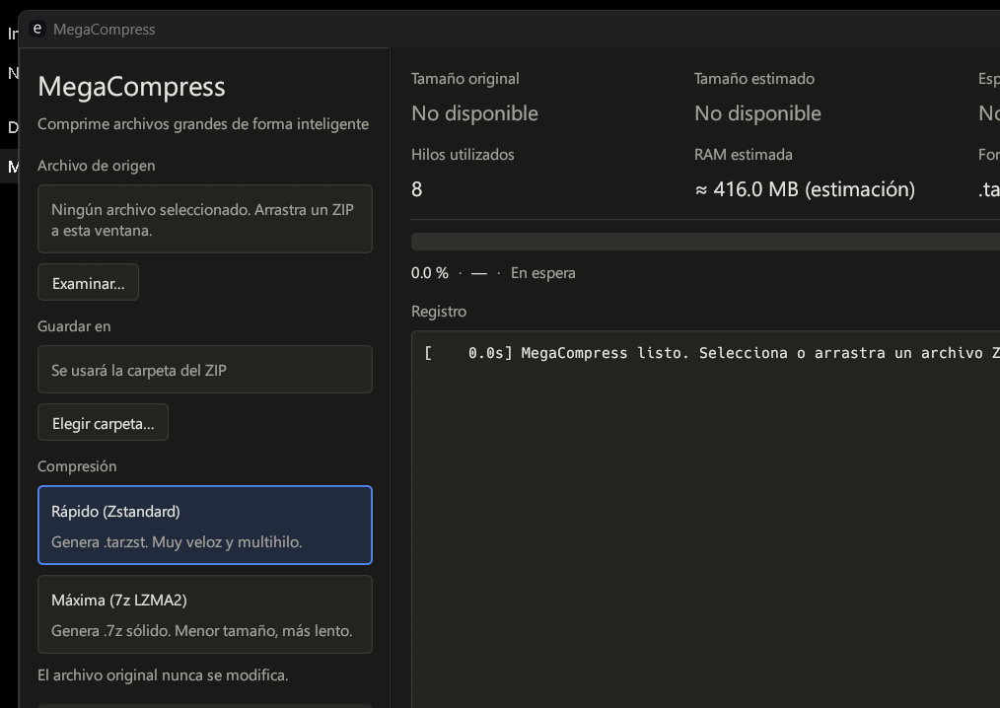

# MegaCompress

**Español** | [English](README.en.md)


Reempaqueta un ZIP grande en un contenedor más eficiente. Una pantalla, modo oscuro:
**seleccionar ZIP → elegir modo → COMPRIMIR**.

| Modo | Algoritmo | Salida |
|---|---|---|
| **Rápido** | Zstandard multihilo (`zstdmt`, checksum por frame) | `.tar.zst` |
| **Máxima** | LZMA2 sólido (`sevenz-rust2`, Rust puro) | `.7z` |

El resultado **no es un `.zip`**. El ZIP original se abre en solo lectura y **nunca se modifica
ni se elimina**. **No se garantiza reducción**: si más del 70 % del contenido son formatos ya
comprimidos (JPG, MP4, ZIP, PDF…), la app avisa antes de empezar y preselecciona Rápido.



## Índice

- [Estado](#estado)
- [Descargar y compilar](#descargar-y-compilar)
- [Requisitos](#requisitos)
- [Cómo funciona](#cómo-funciona)
- [Seguridad](#seguridad)
- [Pruebas](#pruebas)
- [Limitaciones conocidas](#limitaciones-conocidas)
- [Estructura del proyecto](#estructura-del-proyecto)
- [Mediciones manuales](#mediciones-manuales)
- [Licencia](#licencia)

## Estado

Compilado y probado en **Windows 11** con `rustc`/`cargo` **1.99.1** (`x86_64-pc-windows-gnu`):

| Comando | Resultado |
|---|---|
| `cargo fmt --check` | OK |
| `cargo check --all-targets` | OK |
| `cargo test --all-targets` | **98 pasan, 0 fallan, 7 ignoradas** |
| `cargo clippy --all-targets --all-features -- -D warnings` | OK |
| `cargo build --release` | OK (3 min 38 s en la primera compilación) |

El ejecutable de esta entrega está en `dist/MegaCompress.exe`. La app se lanzó y se capturó;
la captura está en [`docs/ui-window.png`](docs/ui-window.png). La comprobación visual fue por OCR
y muestreo de píxeles, no por inspección humana exhaustiva.

Lo que **no** está probado: ZIPs reales de decenas de GB, disco lleno real, ZIP64 >4 GiB,
Linux/macOS y medición de RSS pico. Los números de RAM de `mode.rs` y los tamaños/tiempos
«estimados» de la UI siguen siendo estimaciones. El detalle honesto está en [`AUDIT.md`](AUDIT.md).

## Descargar y compilar

Binario incluido en el repositorio:

- [`dist/MegaCompress.exe`](dist/MegaCompress.exe) — 8 526 104 bytes
- SHA-256: `BAEC53FA41E7C03F04323ED631B857C30E41CC0285E5F1CF17B225FCCC44E72A`
- Solo depende de DLLs del sistema (no necesita `libgcc` ni `libstdc++`).
- **No está firmado digitalmente**: Windows SmartScreen puede mostrar un aviso.

Para compilarlo tú mismo:

```bash
cargo fmt --check
cargo check --all-targets
cargo test --all-targets
cargo clippy --all-targets --all-features -- -D warnings
cargo build --release
```

El binario queda en `target/release/` (`megacompress.exe` en Windows).

## Requisitos

- **Rust ≥ 1.89** (`rustup`): se usa `std::fs::File::try_lock` para el bloqueo de temporales.
- **Windows:** toolchain MSVC (Visual Studio Build Tools, carga «Desarrollo para el escritorio
  con C++») o GNU. Esta entrega se compiló con `x86_64-pc-windows-gnu`. `zstd` y `bzip2`
  compilan C; `sevenz-rust2` no necesita C.
- **Linux:** compilador C, `pkg-config` y, para el diálogo de archivos, GTK3
  (`libgtk-3-dev` en Debian/Ubuntu), más las librerías habituales de eframe (X11/Wayland, OpenGL).
  **No probado en esta entrega.**
- **macOS:** Xcode Command Line Tools. **No probado en esta entrega.**
- Tipografía: se carga una fuente del sistema (Segoe UI en Windows) al arrancar; si no existe,
  se usa la de egui.

## Cómo funciona

```text
lector ZIP (1 hilo) → CheckedReader (CRC32, tamaño, cancelación, progreso)
                    → Sink → cierre → verificación integral → publicación
```

- **Interfaz:** barra lateral (origen, destino, modo, COMPRIMIR/CANCELAR) y área principal
  (estadísticas, progreso en tres etapas, consola). Arrastrar y soltar un ZIP funciona en toda
  la ventana.
- **Rápido:** TAR en streaming → `zstd::Encoder` (nivel y workers según RAM/núcleos).
- **Máxima:** las entradas pequeñas se agrupan en bloques sólidos LZMA2 (64/128/256 MB según RAM);
  una entrada mayor que el bloque se transmite en streaming como bloque propio.
- **Archivos de 0 bytes:** se registran sin stream en 7z (`has_stream = false`, `size = 0`) y se
  verifican aparte. Probado con dos archivos vacíos rodeando a uno con contenido.
- **Verificación (ambos modos, siempre, antes de publicar):** se descomprime todo el resultado y se
  compara el CRC32 y el tamaño de cada archivo con los del **ZIP original**. Si hay una discrepancia,
  no se publica nada.
- **Progreso:** 0–80 % compresión (bytes descomprimidos entregados al Sink); durante la finalización
  la barra queda en 80 % y se muestra el paso real (sin porcentaje inventado); 90–99,5 % verificación;
  el 100 % solo aparece cuando el resultado ya está publicado.
- **Espacio:** se estima con el tamaño descomprimido declarado; se rechaza solo lo claramente
  inviable, se avisa en la zona gris y un disco lleno a mitad de proceso se detecta por **código de
  error del sistema** (no por texto), se detiene todo y se borra el temporal (original intacto).
- **Temporales:** cada operación crea `*.megacompress.lock` (bloqueado por el SO) y
  `*.megacompress.tmp`. Dos instancias no se pisan; la limpieza nunca borra un temporal activo y
  recupera los de procesos muertos.
- **Publicación:** nombre final reservado con `create_new`; nunca sobrescribe. Si el nombre existe,
  se usa `archivo (1).ext`, `archivo (2).ext`, etc.
- **Pánico del motor:** se captura y se convierte en un error visible en la UI; la interfaz no se
  queda esperando.
- **Log técnico:** `%APPDATA%\MegaCompress\logs\megacompress.log` en Windows;
  `~/.local/share/MegaCompress/logs/` en Linux/macOS.

## Seguridad

- Rechaza `..`, rutas absolutas/UNC, unidades, `:` (ADS), nombres terminados en `.` o espacio,
  caracteres inválidos (`<>"|?*` y controles) y nombres reservados de Windows (`CON`, `NUL`,
  `COM1`…, `LPT9`, `CONIN$`, `CONOUT$`) con o sin extensión.
- Rechaza **duplicados reales**, incluidos los que el crate `zip` colapsaría: se lee el directorio
  central en bruto antes de abrir el ZIP con el crate.
- Rechaza colisiones de mayúsculas/minúsculas, `a//b` frente a `a/b` y colisiones tras normalizar
  a **NFC**.
- **Symlinks:** se detectan por el modo Unix `0o120000`, **no se reproducen** (su destino podría
  escapar del árbol), se cuentan y la UI avisa antes y después. No se rechaza el ZIP completo para
  no bloquear archivos legítimos.
- Rechaza cifrado, multivolumen y métodos Deflate64/LZMA/PPMd/XZ.
- **Anti ZIP bomb:** por defecto 100 GiB descomprimidos, ratio 1000:1 y 1 000 000 de entradas.
  Ajustable con `MEGACOMPRESS_MAX_UNCOMPRESSED_GB`, `MEGACOMPRESS_MAX_RATIO`,
  `MEGACOMPRESS_MAX_ENTRIES` y `MEGACOMPRESS_RATIO_MIN_MB`.
- El ZIP original se abre con `File::open` (solo lectura) y nunca se borra.

## Pruebas

`cargo test --all-targets` en esta entrega: **98 pasan, 0 fallan, 7 ignoradas**. Las 7 ignoradas son
el helper de estabilidad y las 6 pruebas de estrés (no ejecutadas).

| Grupo | Dónde | Cómo |
|---|---|---|
| Unitarias | `src/**` (`#[cfg(test)]`) | `cargo test --lib` |
| Integración | `tests/integration_*.rs` (seguridad, integridad, estabilidad, cancelación, corrupción, ida y vuelta rápida, Zip64 forzado) | `cargo test` |
| Estrés | `tests/stress.rs` (`#[ignore]`: ZIP de 1/5/10/20 GB, 1 fichero enorme, 900 000 entradas, Zip64 real >4 GiB, disco lleno real) | `cargo test --release --test stress -- --ignored --nocapture --test-threads=1` (ver cabecera del archivo) |
| Manuales | tabla siguiente, con ZIP reales | a mano |

`cargo test` normal **no** genera decenas de GB. Las pruebas de estrés solo imprimen tiempos; no
afirman rendimiento.

Notas:

- Las «imágenes» de los fixtures son ruido sintético.
- Zip64 en `integration_zip64.rs` solo fuerza cabeceras Zip64 en archivos pequeños; lo real >4 GiB
  es `stress_real_zip64_over_4gib`.
- La prueba de cierre inesperado lanza un proceso hijo real y lo mata.
- La prueba de ida y vuelta rápida comprime un ZIP pequeño, extrae el `.tar.zst`, compara bytes y
  CRC32, y comprueba que el ZIP original no cambió y que no quedan temporales.

## Limitaciones conocidas

- Los enlaces simbólicos del ZIP **se omiten** (y se avisa).
- La verificación integral añade una pasada de descompresión del resultado (en 7z, lenta como LZMA2;
  sin medir).
- ZIP legítimos con `:`, `?`, `*`… o nombres con punto final se rechazan por seguridad.
- Archivos enormes casi vacíos (≈1000:1) chocan con el límite anti-bomba por defecto (configurable).
- La hora DOS del ZIP se interpreta como UTC.
- En **Máxima**, la compresión sólida es **por bloque** (hasta `block_bytes`); una entrada mayor que
  el bloque se transmite como su propio bloque. `sevenz-rust2` no ofrece sólido de archivo completo
  en streaming. La alternativa para eso sería `.tar.xz` con un codificador xz en streaming (no
  implementada).
- En **Máxima**, un bloque ya enviado al codificador no se puede interrumpir: cancelar puede tardar
  hasta lo que tarde ese bloque.
- Un ZIP con millones de entradas guarda en RAM el mapa de CRCs esperados para verificar.
- El log no rota.
- La estimación de tiempo de Máxima es una muestra de ~10 MB × factor de hilos **heurístico**.
- No se ha medido el RSS pico real; el presupuesto de RAM es una estimación de `mode.rs`.
- El `.exe` no está firmado digitalmente.

## Estructura del proyecto

```text
src/
  engine/      pipeline, lector ZIP, sinks .tar.zst/.7z, orquestador, progreso
  fs/          rutas seguras, publicación atómica, espacio libre
  ui/          interfaz eframe/egui
  verify/      CRC32, verificación de .tar.zst y .7z
  app_state.rs, error.rs, logging.rs, main.rs
tests/         integration_*.rs y stress.rs
docs/          captura de la interfaz
dist/          MegaCompress.exe
```

## Mediciones manuales

**Sin datos todavía**; rellenar al medir con ZIPs reales:

| Tamaño ZIP | Modo | Tiempo | RAM máx. | Resultado | Reducción |
|---|---|---|---|---|---|
| 1 GB | Rápido | — | — | — | — |
| 1 GB | Máxima | — | — | — | — |
| 5 GB | Rápido | — | — | — | — |
| 5 GB | Máxima | — | — | — | — |
| 10 GB | Rápido | — | — | — | — |
| 10 GB | Máxima | — | — | — | — |
| 20 GB | Rápido | — | — | — | — |
| 20 GB | Máxima | — | — | — | — |

## Licencia

MIT. Consulta el archivo de licencia del repositorio.
